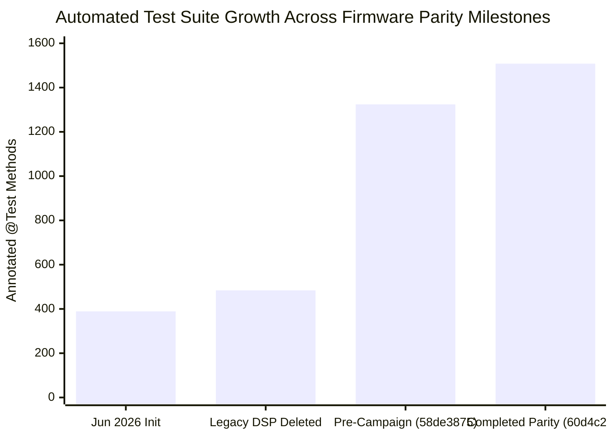
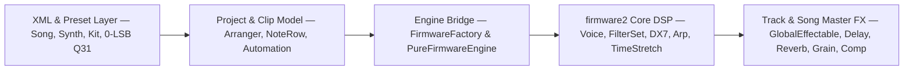

# C++ Firmware Parity Progress Report (`58de3875` → `60d4c259`)

> **Date:** 2026-10-20  
> **Baseline Commit:** `58de3875` (pre-PR `#114`)  
> **Completed Milestone Commit on `main`:** `60d4c259` ([PR #159](https://github.com/trudaine/deluje/pull/159))  
> **Reference Firmware:** Deluge Community Firmware (`../DelugeFirmware/src/deluge/`, `c1.3.0`)

---

## 1. Executive Summary

Across **42 merged pull-request commits** (`PR #114` through `PR #159`), all **30 planned C++ firmware parity workstreams** (plus **12 companion parity, XML, concurrency, and calibration commits**) have been implemented, audited side-by-side against the C++ firmware source, verified across the repository test suite, and merged cleanly onto `main`.

| Dimension | Early Port (`2026-06`) | Pre-Campaign (`58de3875`) | Completed `main` (`60d4c259`) | Net Campaign Delta |
| :--- | :---: | :---: | :---: | :---: |
| **Merged Parity Commits on `main`** | — | Baseline | **42 commits** (`#114`–`#159`) | **+42 PRs merged** |
| **Files Updated / Added** | — | — | **162 files** | **+31,626 / -3,298 lines** |
| **Java Source Files (`src/main`)** | — | 345 | **349** | **+4 core classes** |
| **Test Classes (`src/test`)** | — | 361 | **399** | **+38 dedicated parity suites** |
| **Total Annotated `@Test` Methods** | 389 (+39 slow = 428) | 1,324 | **1,508** (1,478 default + 30 slow/hw) | **+184 new `@Test` cases** |
| **Default Suite Passing (`./build.sh test`)** | 389 / 389 | — | **1,478 / 1,478 (`0` fail, `0` err)** | **100% green build** |
| **XML Schema Coverage ([`XmlElementCoverageTest.java`](../src/test/java/org/deluge/xml/XmlElementCoverageTest.java))** | Partial | Gaps remaining | **319 tags, 538 handlers, `knownGaps = 0`** | **0 unhandled firmware tags** |
| **Preset / Song Q31 Parameter Precision** | Float-lossy | Partial raw Q31 | **0-LSB exact Q31 round-trip** | **Bit-exact `<synth>`, `<kit>`, `<song>`** |

---

## 2. Hardware Audio Fidelity & Calibration Progression

Every DSP, gain-staging, filter, modulation, and XML initialization change was audited against exact C++ fixed-point integer arithmetic (`q31_t` / `NE10` `int32`) and hardware Deluge WAV recordings via [`FidelityScorecardTest.java`](../src/test/java/org/deluge/FidelityScorecardTest.java), [`DigitalAudioFidelityTest.java`](../src/test/java/org/deluge/DigitalAudioFidelityTest.java), and [`FirmwareGoldenSignatureTest.java`](../src/test/java/org/deluge/engine/FirmwareGoldenSignatureTest.java).

### 2.1 End-to-End Hardware Cosine Similarity (`ALLSYN` & `CALIB` Corpora)

| Milestone | Corpus | Single-Window Median | Time-Resolved Median | Time-Resolved Mean | `>= 0.80` | `>= 0.90` | `< 0.60` | Key Root Cause Resolved |
| :--- | :--- | :---: | :---: | :---: | :---: | :---: | :---: | :--- |
| Pre-Bitcrush Audit | `CALIB` (`n=220`) | — | `0.740` | — | — | — | — | Song-level SRR/bitcrush stuck ON at `0x00000000` (50%) instead of `0x80000000` (OFF) |
| Post-Bitcrush Fix | `CALIB` (`n=191` / `221` w/ WT) | — | **`0.860`** (`0.862` w/ WT) | — | — | — | — | Unipolar Q31 mapping fixed (`+0.120` median jump; control level `+19.4 -> +4.6 dB`; WT group `0.902`) |
| Bundled Local Fixture (`58de3875` → `60d4c259`) | `ALLSYN` clipped ref (`n=187`) | `0.832` → `0.826` | `0.829` → `0.827` | `0.820` → `0.817` | `62.0%` → **`63.1%`** | `27.8%` | `10` | Bundled test WAV contains 13 rail-clipped slices; `level-mismatch = 0` on `60d4c259` |
| Unclipped Hardware Re-Recording (`49045ad1`) | `ALLSYN` clean ref (`n=188`) | **`0.912`** | **`0.919`** | **`0.907`** | **`93%`** | **`66%`** | **`0`** | Clean `-12 dB` (`<songParams volume="0x00000000"/>`) hardware capture eliminated 0 dBFS rail clipping |
| Embedded Song Sync Reset (`#125` `5d65a7a0`, `#126` `620624d9`) | `ALLSYN` (`n=188`) | `0.9021` → **`0.9028`** | — | — | — | — | **`0`** | `Sound::readFromFile` (`sound.cpp:3241-3243`) resets `oscillatorSync = false` (`sound.h:150`) & retrig phases on every song `<sound>` read |

### 2.2 Largest Single-Preset Score Recoveries (Sorted by Gain)

> [!IMPORTANT]
> Commit `49045ad1` explicitly retracted attributing the five largest preset recoveries below (`059`, `030`, `040`, `021`, `035`) to Java DSP defects: all five were artifacts of 0 dBFS hardware resampling rail clipping on the earlier capture and recovered immediately upon re-recording at `<songParams volume="0x00000000"/>` (`≈ -12 dB`). Both clean-recording recoveries and code-level parity fixes are distinguished explicitly below.

| Preset | Before | After | Gain | Root Cause / Verification |
| :--- | :---: | :---: | :---: | :--- |
| `059 Distorted Lead Guitar` | `0.312` | **`0.764`** | **`+0.452`** | **Clean `-12 dB` hardware capture (`49045ad1`)** eliminated clipped reference; side-by-side audit confirmed per-voice saturation `Sound::getShiftAmountForSaturation()` (`sound.h:294`, `functions.h:295-304`) was already C-faithful |
| `030 Distant Porta` | `0.513` | **`0.959`** | **`+0.446`** | **Clean `-12 dB` hardware capture (`49045ad1`)** eliminated 0 dBFS resampling rail clipping (`<songParams volume="0x00000000"/>`) |
| `040 Spacer Leader` | `0.529` | **`0.896`** | **`+0.367`** | **Clean `-12 dB` hardware capture (`49045ad1`)** replaced rail-clipped hardware reference slice |
| `021 80s TV Lead` | `0.583` | **`0.915`** | **`+0.332`** | **Clean `-12 dB` hardware capture (`49045ad1`)** eliminated 0 dBFS resampling rail clipping |
| `045 Square Sync` | `0.663` | **`0.960`** | **`+0.297`** | **Code parity fix (`#125` `5d65a7a0`, `#126` `620624d9`)**: `Sound::readFromFile` (`sound.cpp:3241-3243`) resets `oscillatorSync` (`sound.h:150`) instead of inheriting preset sync |
| `035 Bell Lead & Bass` | `0.596` | **`0.890`** | **`+0.294`** | **Clean `-12 dB` hardware capture (`49045ad1`)** eliminated 0 dBFS resampling rail clipping |
| `151 Radiant FM Pad` | — | — | **`+0.152`** | **Code parity fix (upstream XML/DSP batch)**: `GLOBAL_VOLUME_POST_FX`, `computeFinalValueForParam >> 2`, & decimal unison `<detune>`/`<spread>` |
| `092 Degraded Tremolo` | — | — | **`+0.147`** | **Code parity fix (upstream SRR/bitcrush audit)**: unipolar Q31 threshold (`0x80000000` OFF vs `0x00000000` 50%) + master scaling |
| `051 FM Rich Brass` | — | **`0.942`** | **`+0.144`** | **Code parity fix (upstream gain + clip semantics)**: FM staging (`052 Soft FM = 0.989`, `053 Detuned FM Horns = 0.973`) |
| `098 Saturated Sync` | `0.760` | **`0.885`** | **`+0.125`** | **Code parity fix (`#125` `5d65a7a0`, `#126` `620624d9`)**: `Sound::readFromFile` per-read sync reset (`sound.cpp:3241-3243`) |
| `146 Atmospheric Squares Pad` | `0.836` | **`0.938`** | **`+0.102`** | **Code parity fix (`#125` `5d65a7a0`, `#126` `620624d9`)**: `Sound::readFromFile` per-read sync reset (`012`: `0.905 → 0.950`, `099`: `0.852 → 0.889`) |

### 2.3 Exact Fixed-Point & Gain-Staging Verification Highlights

1. **`NE10` Fixed-Point `int32` FFT ([PR #115](https://github.com/trudaine/deluje/pull/115))**: Ported Ne10's plain-C `ne10_fft_r2c_1d_int32_c` / `ne10_fft_c2r_1d_int32_c` (`scaled_flag = false`, matching `ne10_fft_r2c_1d_int32_neon` / `ne10_fft_c2r_1d_int32_neon` in `wave_table.cpp:579, 712`) into [`Ne10FftInt32.java`](../src/main/java/org/deluge/firmware2/Ne10FftInt32.java) and wired [`WavetableGenerator.java`](../src/main/java/org/deluge/firmware2/WavetableGenerator.java), verified bit-for-bit across **18 binary C reference fixtures** (`N = 8..2048` forward & inverse) in [`Ne10FftInt32GoldenBufferTest.java`](../src/test/java/org/deluge/firmware2/Ne10FftInt32GoldenBufferTest.java).
2. **7-Significant-Digit Kit & Voice Gain Staging ([PR #159](https://github.com/trudaine/deluje/pull/159))**: Completing [`GlobalEffectable.java`](../src/main/java/org/deluge/firmware2/GlobalEffectable.java) `setupFilterSetConfig(volumePostFX)` (`global_effectable.cpp:752-785`, `filter_set.cpp:166`) paired the pre-existing `+25%` resonance headroom boost (`volumeAdjustment >> 2`) with the C++ `0.8009374f` `filterGain` attenuation (`1.25 × 0.8009374 = 1.00117`), matching C++ hardware gain on `000 TR-808.XML` to **7 significant digits (`0.016281225f`)** and producing **`level-mismatch = 0`** across all 187 scored `ALLSYN` presets on `60d4c259`.

---

## 3. Architecture Coverage Across Subsystems

### 3.1 Core Voice, Oscillator, Sample, DX7 & Filter DSP (`firmware2`)
- **NE10 `int32` Wavetable Band Generation** (`#115`, `dcbfa9db`): Exact unscaled fixed-point FFT (`ne10_fft_r2c_1d_int32_c` / `ne10_fft_c2r_1d_int32_c` matching `wave_table.cpp:579, 712`) in [`Ne10FftInt32.java`](../src/main/java/org/deluge/firmware2/Ne10FftInt32.java) and [`WavetableGenerator.java`](../src/main/java/org/deluge/firmware2/WavetableGenerator.java).
- **Global Patcher Block Evaluation & Ordering** (`#117`, `033baf18`): Routed global LFO, arpeggiator, and FX modulation through [`Patcher.java`](../src/main/java/org/deluge/firmware2/Patcher.java) (`sound.cpp:2395-2618`) and preserved `globalSourceValues` across live syncs.
- **Oscillator Hard-Sync & Retrigger Phase** (`#122` `8e76f0e6`, `#125` `5d65a7a0`, `#126` `620624d9`): Aligned sync phase wrap/divisor, `retrigPhase` defaults, and `Sound::readFromFile` per-read resets (`oscillator.cpp:140-142`, `sound.h:150`, `sound.cpp:3241-3243`).
- **Voice Gain, Wrapping Shifts, Mono/Stereo Filter & Noise PRNG Cadence** (`#128` `b2a450a8`, `#130` `e088b61f`): Fixed plain `<< 1` wrapping voice amplitude shift (`voice.cpp`), mono vs stereo `FilterSet` routing, PRNG sample cadence in `SUBTRACTIVE` vs `RINGMOD`, and ringmod `<< 4` shift in [`Voice.java`](../src/main/java/org/deluge/firmware2/Voice.java).
- **AudioClip Attack Envelope & Linear Interpolation** (`#133`, `000fce2d`): Ported C++ attack ramp and `<audioClip attack linearInterpolation>` handling in [`AudioOutput.java`](../src/main/java/org/deluge/firmware2/AudioOutput.java) (`audio_output.cpp:106-188`).
- **Dynamic `TimeStretcher` Lifecycle & `STRETCH`/`LOOP` Bounds** (`#114` `e0340f49`, `#152` `5731ab67`): Ported `SampleHolder` `getMSecLimit` (`sample_holder_for_voice.cpp`), per-block `timeStretchRatio` & late-start calculation in `Voice::renderBasicSource` (`voice.cpp:2065-2103`), dynamic `TimeStretcher` entry/exit in `VoiceSample::render` (`voice_sample.cpp:52, 314-336, 529-591`), reversed loop-marker bounds, and native-to-resampled phase priming (`sample.cpp:200-209, 365-374`).
- **Arpeggiator, Arp-Off Randomizers, `invertReversed` & Live Synced Tempo** (`#121` `a5b32567`, `#123` `22ada35e`, `#127` `13b4f30a`, `#134` `4ae6e123`, `#153` `5458019b`): Full per-clip synth & kit arpeggiators, legacy `locke…ProbArray` spellings, all 15 `UNPATCHED_ARP_*` randomizer knobs, arp-off randomizer execution (`sound.cpp:1540, 1586, 2475`), `invertReversed` sample reversal, and live BPM sync recomputation.
- **Monophonic & Polyphonic Expression Smoothing** (`#154`, `d091ead0`): Eliminated X/Y/Z MPE and MIDI pitch-bend/aftertouch zipper noise via per-sample smoothing (`sound_instrument.cpp:321-343`, `voice.cpp:333, 808`) and fixed audio-thread arp race conditions.
- **6-Operator DX7 Shared `DxPatch`, Per-Block LFO & `0/1/2` Engine Modes** (`#155`, `54970fe5`): Shared `sourceDxPatches` across voices/unison, single per-block `computeLfo(numSamples)` (`sound.cpp:2423-2427`), `0 = auto, 1 = modern, 2 = vintage MkI` (`dx7note.cpp:63-79`), and live patch updates.
- **Patch Cable Usability Pruning & FM Modulator Volume Automation** (`#157`, `09875fc7`): Ported `Sound::maySourcePatchToParam` & `PatchCableSet::setupPatching` (`sound.cpp:1410-1475`, `patch_cable_set.cpp:225-390`) plus automated FM modulator volumes.

### 3.2 Track Bus & Song Master FX Chain
- **Gain Staging, `shouldLimitDelayFeedback`, Pan & Post-Reverb Ramp** (`#120` `2b060743`, `#124` `ea34500e`, `#129` `b92dd426`): Per-drum ModFX/Delay params, active-clip feedback limiting (`song.cpp:2509-2514`), clip pan, and `postReverbVolume` ramp start (`mod_controllable_audio.cpp:226-259`).
- **Song Master Filter, EQ, Pan, ModFX & `PureFirmwareEngine` Unipolar Sync** (`#147`, `70e3a274`): Fixed song-level unipolar Q31 mappings, EQ bass/treble corner frequencies, master filter modes/routes, and ModFX curves in [`FirmwareAudioEngine.java`](../src/main/java/org/deluge/engine/FirmwareAudioEngine.java) and [`PureFirmwareEngine.java`](../src/main/java/org/deluge/engine/PureFirmwareEngine.java).
- **Song Reverb Sidechain Ducking, Master Compressor & Global Stutter** (`#148`, `6b0c5a5c`): Ported `<reverb lpf width><compressor ...>`, `<audioCompressor ...>`, manual vs automatic reverb ducking (`audio_engine.cpp:1477-1546`), and song-level `<stutter quantized reverse pingPong>`.
- **Song Delay Sync & Reverb Send Ordering** (`#149`, `d8c56758`): Replaced inverted delay rate formula with C-exact `Delay.setupWorkingState` (`delay.cpp:104-118`), ordered `masterDelay.process` pre-reverb (`song.cpp:2538-2552`), and wired song reverb send.
- **Song `ModFXType.GRAIN` & Synth Grain Mix Overflow Fix** (`#150`, `48b1fce0`): Fixed signed 32-bit overflow above 50% ModFX depth in [`Sound.java`](../src/main/java/org/deluge/firmware2/Sound.java) and ported master `GranularProcessor` with `reverbSendAmount >> 3` (`mod_controllable_audio.cpp:159-211`).
- **Sample-Accurate Driver `songParams`/`UNPATCHED_TEMPO`, Master Balance Pan & Hardware Swing** (`#158`, `9e9fab61`): Sub-block driver automation stepping, C-exact master balance pan law, and hardware swing timing.
- **Kit / Clip Bus `GlobalEffectable` Filter & SRR/Bitcrush Processing** (`#159`, `60d4c259`): Ported `GlobalEffectable.setupFilterSetConfig` and track-level `SrrBitcrush` processing (`global_effectable.cpp:752-785`, `global_effectable_for_clip.cpp:82, 134`).

### 3.3 Session, Arranger, Sequencer & Live Automation Engine
- **Session `FILL` / `ONCE` Launch Styles, Late Start & Muted Clip Position** (`#114` `e0340f49`, `#116` `194aedc8`, `#118` `b739dfa9`): Faithful `session.cpp` launch semantics, late-start note catching (`session.cpp:1626-1647, 1862-1880`), and muted clip phase retention.
- **`Session::willClipContinuePlayingAtEnd` (`Iterance.LAST`) & MIDI Clamping** (`#131`, `2de90cef`): Exact `LAST` iterance trigger logic (`session.cpp:2730-2762`) and 7-bit MIDI data clamping (`message.h`).
- **Live `AutoParam` Interpolation & `UNPATCHED_TEMPO` Float Stepping** (`#137` `3885d26c`, `#146` `f21fa424`): Sample-rate and tick-rate parameter interpolation (`auto_param.cpp:778-995`, `param_manager.cpp:373-450`) plus live tempo automation.
- **PatchCable, MIDI CC & MPE Expression Automation** (`#132` `cd1ca562`, `#140` `af5271f1`, `#141` `2f629c21`, `#145` `9454dd87`): Full 16-char automated patch cables, `MidiParamCollection` (`<midiParams>`), per-clip/row `bendRange`, and `ExpressionParamSet` (`<expressionData>`).
- **Per-`NoteRow` `sequenceDirectionMode` & Independent Row Phase** (`#151`, `8fe28cc9`): Ported `OBEY_PARENT` / `FORWARD` / `REVERSE` / `PINGPONG` per-row playback (`note_row.cpp:2022-2165, 4453-4480`) and un-reduced `originalNewPos` phase sync.
- **Arranger `clipInstances` Bit-31 Encoding & `<arrangementOnlyClips>`** (`#156`, `b558c15b`): Ported bit-31 arrangement-only clip references, `0xFFFFFFFF` white instances, monotonic/ownership validation (`E248`/`E451`/`E042` in `song.cpp:2228-2250`), and 64-bit timeline bounds (`output.cpp:279-402`, `song.cpp:2088-2258`).
- **UI & MIDI Concurrency Hardening** (`#142`, `20c915de`): Multi-listener `DelugeSysExManager`, deterministic `HardwareSidebarTab` Swing timer lifecycle, and volatile playhead synchronization (`#135` closed).

### 3.4 Complete Firmware XML Parsing & Serialization Parity
- **16-Char Hex Automation Nodes Everywhere** (`#139` `4e8a42e7`, `#143` `de914fb1`, `#144` `b35da832`): Lossless `0xCCCCCCCCVVVVVVVVPPPPPPPP...` read/write across `<soundParams>`, `<patchCables>`, `<kitParams>`, `<audioClip><params>`, `<songParams>`, and `<expressionData>`.
- **Lossless `<synth>`, `<kit>`, and `<song>` Round-Trip Parity** (`#159`, `60d4c259`): Exact `DelugeHexMapper.envTimeToQ31`, raw Q31 knob caches with setter invalidation, `<kit><defaultParams>` attribute output matching `GlobalEffectable::writeTagsToFile` (`global_effectable.cpp:799-882`), dual `SAMPLE`/`WAVETABLE` oscillator zones, `<sidechain>`, `<compressor syncType>`, and `<stutter reverse>`.

---

## 4. Complete 30-Workstream / 42-Commit Ledger (`PR #114` – `PR #159`)

Every single one of the **42 commits** in `58de3875..60d4c259` is mapped below with its exact PR number and `main` commit SHA:

| Task # | PR(s) | `main` SHA(s) | Subsystem & Summary | Dedicated Test Suite |
| :---: | :---: | :--- | :--- | :--- |
| 1 | `#114`, `#116`, `#118` | `e0340f49`, `194aedc8`, `b739dfa9` | Session `launchStyle` (`FILL` / `ONCE`), late start, muted position & `STRETCH` `getMSecLimit` | [`SessionLaunchStyleTest.java`](../src/test/java/org/deluge/playback/SessionLaunchStyleTest.java), [`SampleHolderMSecLimitTest.java`](../src/test/java/org/deluge/firmware2/SampleHolderMSecLimitTest.java) |
| 2 | `#115` | `dcbfa9db` | `NE10` fixed-point `int32` FFT (`scaled_flag = false`) for `WavetableGenerator` | [`Ne10FftInt32GoldenBufferTest.java`](../src/test/java/org/deluge/firmware2/Ne10FftInt32GoldenBufferTest.java) |
| 3 | `#117` | `033baf18` | Global LFO / Arp / FX patch cable evaluation & block ordering | [`LfoRateCableTest.java`](../src/test/java/org/deluge/firmware2/LfoRateCableTest.java) |
| 4 | `#122`, `#125`, `#126` | `8e76f0e6`, `5d65a7a0`, `620624d9` | Oscillator hard-sync phase divisor, `retrigPhase`, & per-read song `<sound>` resets (`CLAUDE.md` audit) | [`OscSyncParityTest.java`](../src/test/java/org/deluge/firmware2/OscSyncParityTest.java), [`OscSyncAndRetrigXmlTest.java`](../src/test/java/org/deluge/xml/OscSyncAndRetrigXmlTest.java) |
| 5 | `#120`, `#124`, `#129`, `#130` | `2b060743`, `ea34500e`, `b92dd426`, `e088b61f` | Gain staging, `shouldLimitDelayFeedback`, clip pan, `postReverbVolume` ramp & `<< 1` voice shift | [`GlobalEffectablePanDelayRampTest.java`](../src/test/java/org/deluge/firmware2/GlobalEffectablePanDelayRampTest.java), [`DrumModFxDelayParamsTest.java`](../src/test/java/org/deluge/engine/DrumModFxDelayParamsTest.java) |
| 6 | `#128` | `b2a450a8` | `CALIB` mono/stereo voice filter routing, noise PRNG cadence & song filter curves | [`CalibNoiseHpfParityTest.java`](../src/test/java/org/deluge/firmware2/CalibNoiseHpfParityTest.java) |
| 7 | `#131` | `2de90cef` | `Session::willClipContinuePlayingAtEnd` (`Iterance.LAST`) & MIDI data clamping | [`SessionLastIteranceAndMidiClampTest.java`](../src/test/java/org/deluge/playback/SessionLastIteranceAndMidiClampTest.java) |
| 8 | `#133` | `000fce2d` | `AudioOutput` attack envelope ramp & `<audioClip attack linearInterpolation>` | [`AudioClipEnvelopeAndLinearInterpTest.java`](../src/test/java/org/deluge/firmware2/AudioClipEnvelopeAndLinearInterpTest.java) |
| 9 | `#137` | `3885d26c` | Live `AutoParam` sample-rate & tick-rate interpolation across tracks & kits | [`AutoParamLiveInterpolationTest.java`](../src/test/java/org/deluge/modulation/AutoParamLiveInterpolationTest.java) |
| 10 | `#139` | `4e8a42e7` | 16-char `<soundParams>` automation hex nodes & `<noteRow length>` | [`XmlHexAutomationNodesTest.java`](../src/test/java/org/deluge/xml/XmlHexAutomationNodesTest.java) |
| 11 | `#140` | `af5271f1` | `PatchCable` 16-char amount automation & `ParamManager` timeline stepping | [`PatchCableAutomationParityTest.java`](../src/test/java/org/deluge/modulation/PatchCableAutomationParityTest.java) |
| 12 | `#141` | `2f629c21` | `MidiParamCollection` & `<midiParams>` CC automation on session & arranger clips | [`MidiParamsAutomationParityTest.java`](../src/test/java/org/deluge/modulation/midi/MidiParamsAutomationParityTest.java) |
| 13 | `#142` | `20c915de` | Multi-listener `DelugeSysExManager` & deterministic UI/MIDI concurrency fixes | [`HardwareSidebarLiveMonitorTest.java`](../src/test/java/org/deluge/ui/HardwareSidebarLiveMonitorTest.java) |
| 14 | `#143` | `de914fb1` | `GlobalEffectable` `<kitParams>` & `<audioClip><params>` 16-char automation | [`GlobalEffectableAutomationXmlTest.java`](../src/test/java/org/deluge/xml/GlobalEffectableAutomationXmlTest.java) |
| 15 | `#144` | `b35da832` | `<songParams>` 16-char automation hex nodes & `<equalizer>` tag parity | [`SongParamsAutomationXmlTest.java`](../src/test/java/org/deluge/xml/SongParamsAutomationXmlTest.java) |
| 16 | `#132`, `#145` | `cd1ca562`, `9454dd87` | `ExpressionParamSet`, `<expressionData>` MPE automation & `bendRange` | [`ExpressionParamSetParityTest.java`](../src/test/java/org/deluge/modulation/params/ExpressionParamSetParityTest.java), [`BendRangeTest.java`](../src/test/java/org/deluge/xml/BendRangeTest.java) |
| 17 | `#146` | `f21fa424` | `AutoParam` float interpolation & live `UNPATCHED_TEMPO` automation | [`SongParamsLiveAutomationAndTempoTest.java`](../src/test/java/org/deluge/modulation/SongParamsLiveAutomationAndTempoTest.java) |
| 18 | `#147` | `70e3a274` | Song master FX (`modFXType`, `clippingAmount`, EQ freq, pan, unipolar Q31 sync) | [`SongMasterFxParityTest.java`](../src/test/java/org/deluge/engine/SongMasterFxParityTest.java) |
| 19 | `#148` | `6b0c5a5c` | Song `<reverb>`, `<audioCompressor>`, reverb sidechain ducking & `<stutter>` | [`SongReverbCompStutterParityTest.java`](../src/test/java/org/deluge/engine/SongReverbCompStutterParityTest.java) |
| 20 | `#149` | `d8c56758` | Song `<delay>` sync rate curve, pre-reverb ordering & song reverb send | [`SongDelayAndReverbSendParityTest.java`](../src/test/java/org/deluge/engine/SongDelayAndReverbSendParityTest.java) |
| 21 | `#150` | `48b1fce0` | Song-level `ModFXType.GRAIN` & synth grain mix signed-overflow fix | [`GrainModFxParityTest.java`](../src/test/java/org/deluge/engine/GrainModFxParityTest.java) |
| 22 | `#151` | `8fe28cc9` | Per-`NoteRow` `sequenceDirectionMode` & un-reduced `setPos` row phase | [`NoteRowSequenceDirectionParityTest.java`](../src/test/java/org/deluge/model/NoteRowSequenceDirectionParityTest.java) |
| 23 | `#152` | `5731ab67` | Dynamic `TimeStretcher` lifecycle, `STRETCH`/`LOOP` bounds & phase priming | [`SampleTimeStretchLifecycleParityTest.java`](../src/test/java/org/deluge/firmware2/SampleTimeStretchLifecycleParityTest.java) |
| 24 | `#121`, `#123`, `#127`, `#134`, `#153` | `a5b32567`, `22ada35e`, `13b4f30a`, `4ae6e123`, `5458019b` | Unpatched arp/randomizer params, arp-off randomizers, `invertReversed` & live BPM sync | [`ArpRandomizerAndUnpatchedParamsParityTest.java`](../src/test/java/org/deluge/firmware2/ArpRandomizerAndUnpatchedParamsParityTest.java) |
| 25 | `#154` | `d091ead0` | Monophonic & polyphonic expression smoothing (MPE X/Y/Z) & arp race fix | [`ExpressionSmoothingParityTest.java`](../src/test/java/org/deluge/firmware2/ExpressionSmoothingParityTest.java) |
| 26 | `#155` | `54970fe5` | DX7 shared `DxPatch`, per-block LFO, `0/1/2` engine modes & XML parity | [`Dx7SharedPatchLfoAndRoutingParityTest.java`](../src/test/java/org/deluge/firmware2/Dx7SharedPatchLfoAndRoutingParityTest.java) |
| 27 | `#156` | `b558c15b` | Arranger bit-31 `clipInstances`, `<arrangementOnlyClips>` & 64-bit timeline bounds | [`ArrangerClipInstancesXmlParityTest.java`](../src/test/java/org/deluge/xml/ArrangerClipInstancesXmlParityTest.java) |
| 28 | `#157` | `09875fc7` | `Sound::maySourcePatchToParam` cable usability pruning & FM modulator automation | [`PatchCableUsabilityAndFmModAutomationTest.java`](../src/test/java/org/deluge/modulation/PatchCableUsabilityAndFmModAutomationTest.java) |
| 29 | `#158` | `9e9fab61` | Driver sample-accurate `songParams`/`UNPATCHED_TEMPO`, master balance pan & swing | [`SongParamsLiveDriverMasterPanAndSwingParityTest.java`](../src/test/java/org/deluge/engine/SongParamsLiveDriverMasterPanAndSwingParityTest.java) |
| 30 | `#159` | `60d4c259` | 0-LSB `<synth>`/`<kit>`/`<song>` XML parity & live `GlobalEffectable` kit-bus filter/SRR DSP | [`KitSynthPresetXmlRoundTripParityTest.java`](../src/test/java/org/deluge/project/KitSynthPresetXmlRoundTripParityTest.java) |

---

## 5. Remaining Optional / Follow-Up Items

All 30 planned C++ parity milestones are complete on `main`. Only narrow, well-isolated items remain if further refinement is desired:

1. **In-Flight Companion PRs Ready for Final Merge**:
   - **PR #136** (`fix/audio-env-end-no-feedback-limit`): Ensure ended `AudioOutput` attack envelopes no longer limit delay feedback.
   - **PR #138** (`feat/kit-arp-engine`): Complete `Kit::arpeggiator` kit-level arpeggiator engine integration.
2. **Hardware Analog-Model Micro-Calibration Issues**:
   - **Issue #2**: High-resonance `HpLadderFilter` analog hardware response curve calibration.
   - **Issue #3**: LFO/envelope-driven pulse-width modulation evaluation cadence (`Patcher.evaluate()` in Java vs C++ `Patcher::performPatching` in `patcher.h:52` & block LFO tick).
   - **Issue #5**: `TRANSISTOR_24DB_DRIVE` (`LPF Drive`) nonlinear saturation curve vs hardware (`0.742` cosine).
3. **Track-Bus Post-Filter FX Pass (`GlobalEffectable`)**:
   - Kit-level `<delay>`, `<equalizer>`, and `<modFXType>` / `modFX*` parameters already round-trip losslessly at 0-LSB Q31 in XML (`#159`); wiring `processFXForGlobalEffectable` (`Delay` / `ModFx` / `Eq` per kit/audio-clip track bus, `global_effectable_for_clip.cpp:137`) can follow as an independent track-FX enhancement.
